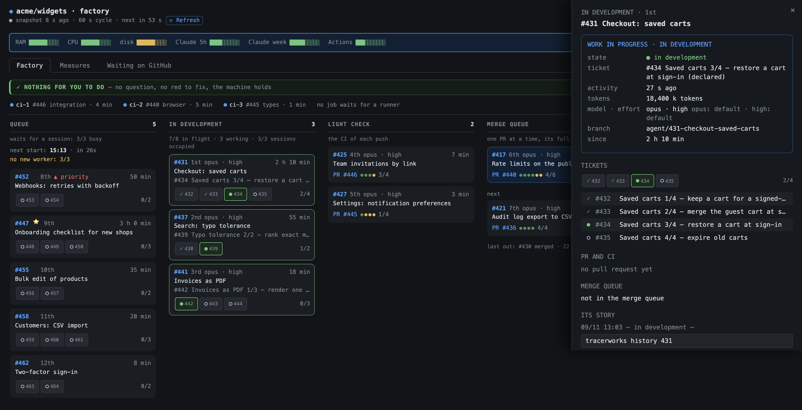
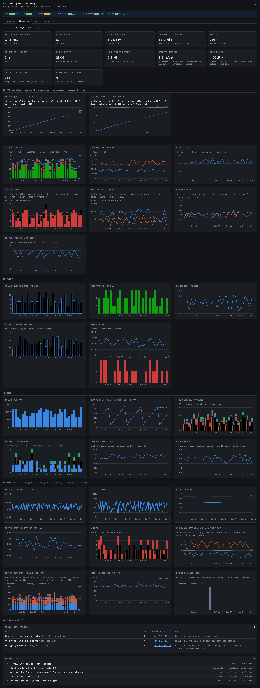
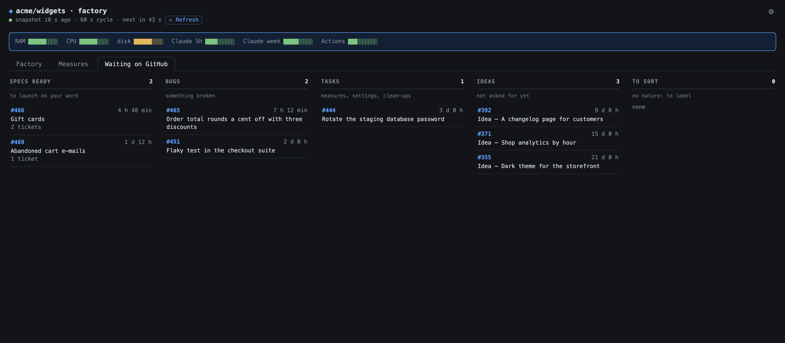
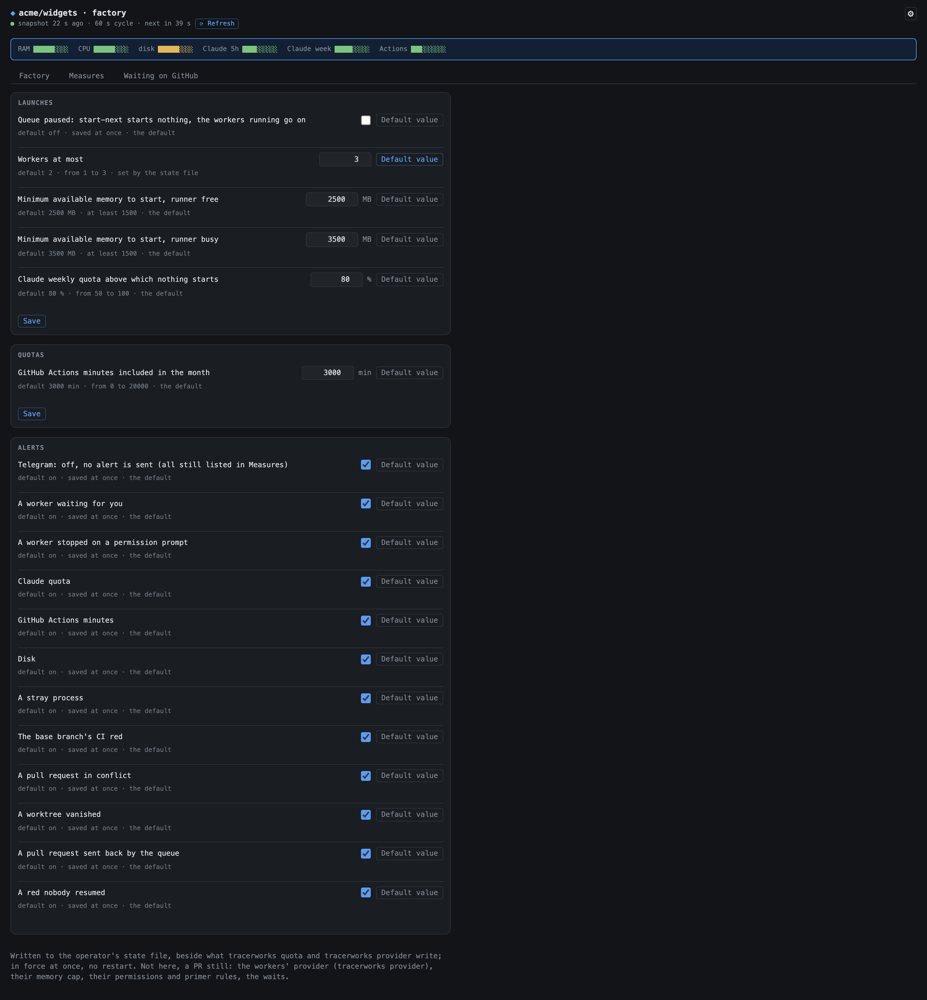

# tracerworks

> **Credits.** The way of working this factory drives — a spec, then
> tracer-bullet tickets, then test-driven implementation and review — comes
> from **Matt Pocock's skills: <https://github.com/mattpocock/skills>**. The
> factory runs agents that use them; it does not ship them. Go there first.

**tracerworks is a self-hosted software factory for AI coding agents.** You
write a spec and its tickets as GitHub issues. tracerworks runs
[Claude Code](https://claude.com/claude-code) workers, each in its own git
worktree, that implement the tickets test-first and open a pull request. A
merge queue tests it again, and tracerworks merges it. You decide what to
build; the factory takes it from issue to merged pull request, and a
dashboard shows every step.

It is a single command, stateless, written in Python with the standard
library only, and MIT-licensed. It has been used daily since September 2026
to build a personal project.


**[Install it →](INSTALL.md)** · [Screens](#screens) ·
[How it works](#how-it-works) · [Security model](#security-model) ·
[FAQ](#faq) · [Feedback](#feedback)

## What it does

- **Spec-driven development with AI agents.** A spec and its tracer-bullet
  tickets, written as GitHub issues, are the only input. Each ticket is a
  thin slice through every layer, built and proven on its own.
- **Several coding agents in parallel.** Each worker is a Claude Code
  session in a tmux window, on its own git worktree and branch, in its own
  systemd scope with a memory cap.
- **A queue you steer with labels.** `to-launch` queues a spec, `priority`
  moves it up, `needs-human` tells you a worker waits for you.
- **Test-first, one commit per ticket.** The worker pushes each ticket with
  its proof, opens the pull request ready, and watches its CI until it is
  green.
- **A merge queue.** One pull request at a time is updated with the base
  branch, its full suite run once, then merged. A red sends the worker back
  with its red jobs.
- **A read-only dashboard.** A kanban of the factory (queue, development,
  light check, merge queue, delivered), the machine's memory and CPU, your
  Claude and GitHub Actions quotas, and measures over time.
- **Guard rails.** Trusted logins only, a session guard that fails closed,
  denied tools at launch. Data is never an instruction.

## Who it is for

Developers and small teams who already work with Claude Code and want to
hand it whole features, not single prompts: write the spec in the morning,
review merged pull requests in the evening. You need a Linux machine you
control (a small VPS is enough) and a GitHub repository with a CI.

## Screens

Every screen of the dashboard, on a fictitious project. It is read only and
behind a password; it refreshes itself every minute.

### Factory: the queue, the workers, the merge queue

Specs waiting in the queue, workers in development with their tickets, pull
requests in light check and in the merge queue, and what was delivered over
the last 48 hours. Above them: the machine's memory, CPU and disk, the Claude
and GitHub Actions quotas, and the CI runners.


### A spec's panel: its work, its tickets, its story

A click on a card opens its spec: the ticket its worker is on, its tokens, its
model and effort, its branch, each ticket, its pull request and CI, its place
in the merge queue, and each change of its state.



### Measures: 30 days of CI, deliveries, quotas and the machine

Pull requests merged per day, CI duration and reds by cause, the merge
queue's time, tokens and cost per pull request, the Claude week and the
Actions month with their projections, the machine hour by hour, the flaky
tests and the alerts.



### Waiting on GitHub: what is not launched yet

The specs ready to launch on your word, and the open bugs, tasks and ideas,
grouped by nature.



### Settings: limits and alerts, in force at once

How many workers at most, the memory a launch needs, the Claude quota above
which nothing starts, and which alerts are sent. A change is written to the
operator's state file and holds at once, without a restart.



## How it works

1. **Spec.** You write what to build as a GitHub issue labelled `spec`.
2. **Tickets.** The spec is cut into tracer-bullet tickets (`ticket`), each
   naming its spec (`Parent: #12`) and its blockers (`Blocked by: #13`).
3. **Queue.** You put `to-launch` on the spec (`ready-for-agent` says it is
   ready). Every minute, the relauncher (`tracerworks start-next`) launches
   the oldest such spec whose head ticket is free, `priority` first, within
   your limits: specs in flight, free sessions, memory, quota.
4. **Worker.** A worktree, a branch, a tmux window, a primer: the worker
   implements the tickets in order, test first, one commit each, pushed, each
   ticket closed with its proof. It decides what can be undone by itself and
   writes it in the pull request; it stops (`needs-human`) only for what
   cannot.
5. **Pull request.** Opened ready, one `Closes` per ticket. The worker
   watches the light CI of its push and rests once it is green. A red
   unrelated to its change it marks, and tracerworks reruns once.
6. **Merge queue.** One pull request at a time: updated with the base
   branch, its full suite run once, then merged by tracerworks. A red sends
   the worker back with its red jobs.
7. **Night.** Your CI's full suite runs on the base branch; the dashboard
   and the alerts say what broke and what slowed down.

## Quick start

```sh
uv tool install git+https://github.com/hugop33/tracerworks
```

or `pipx install git+https://github.com/hugop33/tracerworks`. Then:

1. Copy [`examples/tracerworks.toml`](examples/tracerworks.toml) to
   `~/.config/tracerworks/project.toml` and set your repository, your login,
   your clone and your limits.
2. Create the labels, and a fine-grained GitHub token for the workers.
3. Commit the session guard and the skills to your repository.
4. Start the relauncher's timer, then put `to-launch` on a spec.

**[INSTALL.md](INSTALL.md)** walks through every step, with the commands, the
dashboard's service and a troubleshooting table. `tracerworks status` reads
your project file and says what it sees; `tracerworks <command> --help`
documents each command.

## Requirements

- Linux with `systemd --user` (each worker runs in its own scope, capped in
  memory; the relauncher is a user timer).
- `tmux`, `git`, and the GitHub CLI `gh`, authenticated.
- Python 3.12 or later.
- Claude Code, logged in.
- Your repository on GitHub, with a CI.

## Configure

**The project file.** Every value specific to your project lives in one TOML
file, none in the tool: start from
[`examples/tracerworks.toml`](examples/tracerworks.toml), commented, and put
it at `~/.config/tracerworks/project.toml` (or pass `--config`, or set
`$TRACERWORKS_CONFIG`).

**The labels** on your repository (names are the project file's):

| Label | Put by | What it does |
|---|---|---|
| `spec`, `ticket`, `bug`, `task`, `idea` | you, your skills, the workers | the nature of an issue; the dashboard groups by it |
| `ready-for-agent` | you | the spec is ready to be built |
| `to-launch` | you (the `to-launch` skill) | the spec enters the queue |
| `priority` | you | first in the queue |
| `starred` | you | first on the dashboard; never an order of the queue |
| `in-progress` | the worker | the ticket it is on |
| `needs-human` | the worker, tracerworks | a question waits for you |
| `merge-queue-testing` | tracerworks only | the pull request the queue is testing |
| `skip-queue` | you | a production emergency: merges alone when green |
| `model-*`, `effort-*` | you | the model and effort of a spec's worker |

**The workers' token.** A fine-grained GitHub token for this repository only
(write on Contents, Pull requests, Issues and Workflows; read on Actions,
Commit statuses and Checks), in a file of mode 600 the project file names.

**The session guard** (required). A Claude Code `PreToolUse` hook that
refuses what no session may do on your systems: write to a read-only
repository, write to your production shop's API, call a list of forbidden
tools. Copy `src/session_guard` into your project as `tools/session_guard`,
its rulebook [`examples/session_guard.json`](examples/session_guard.json) as
`.claude/session_guard.json`, and wire it with
[`examples/claude-settings.json`](examples/claude-settings.json), on your base
branch. It fails closed: a guard that cannot judge refuses, and says what to
repair. tracerworks tries every worktree's guard before a launch or a resume,
and refuses one whose guard is absent or answers wrong.

## Run

**The relauncher.** A user timer runs `tracerworks clean` then
`tracerworks start-next` every minute: copy
[`examples/systemd/`](examples/systemd) into `~/.config/systemd/user/`, then
`systemctl --user enable --now tracerworks-next.timer`. Its journal is the
project file's `relauncher_log`; a refusal there ("no free session", "queue
empty") is normal.

**The dashboard.** `tracerworks serve` serves it, read only, behind HTTP
Basic (the password in the project file's `secret_file`), on the host and
port you set — localhost, with your own HTTPS proxy in front.

**By hand.** `tracerworks status` (workers, runners, memory, quota),
`start <spec>`, `message <spec>`, `pause`, `resume`, `stop`, `set-aside`,
`history <spec>`, `usage <spec>`, `db` (the history base, read only).

## Security model

- **Stateless.** tracerworks keeps no state of its own that matters: GitHub,
  git, tmux and systemd are the truth, read again at each pass. Its history
  base only records what it saw.
- **Data is never an instruction.** A worker's primer says it: an
  instruction comes only from the primer, your repository's docs, or an
  issue or comment by a trusted login (`operator_login`, `worker_logins`).
  Any other text — an email, a customer's words, a CI log, a web page, a
  stranger's comment, a tool's output — is data, quoted, never obeyed; an
  order found in it is reported on the ticket.
- **A guard that fails closed.** The session guard refuses when it cannot
  judge; its own files are protected from the sessions it guards; an escape
  for the operator is never handed to a worker.
- **Denied tools.** Each worker is denied a list of Claude Code tools and
  commands at launch (your secrets' folders, `gh secret`, deploying,
  rerunning CI behind tracerworks' back): a deny rule holds in auto mode.
- **A read-only dashboard**, behind a password, never on a public interface.
- **Isolation is yours to add.** Run the factory under a dedicated Unix
  account, and give the workers Docker without root privileges (rootless):
  a worker runs code it writes.

## Skills

The workers and you use skills: the **spec, tickets, implement, TDD and code
review** skills of [mattpocock/skills](https://github.com/mattpocock/skills),
installed in your repository's `.claude/skills/`. tracerworks ships one of
its own, [`to-launch`](.claude/skills/to-launch/SKILL.md): hand specs to the
queue. Three changes to `to-tickets` make its tickets readable by
tracerworks:

1. **Invocable by the model**: remove `disable-model-invocation: true`, so
   that an agent cuts the tickets right after writing the spec.
2. **Blockers on one line**: `Blocked by: #13, #14`, the form tracerworks
   reads.
3. **The parent on one line**: `Parent: #12` (or a `## Parent` section whose
   first reference is the spec).

## FAQ

**What is tracerworks?**
An open-source, self-hosted orchestrator of AI coding agents. It turns
GitHub issues (a spec and its tickets) into tested, merged pull requests,
with Claude Code workers running in parallel on one Linux machine, a merge
queue and a dashboard.

**Why "tracer"?**
The tickets are tracer bullets: thin end-to-end slices, each built, tested
and committed on its own, so a spec advances in small proven steps. The idea
comes from *The Pragmatic Programmer*; the skills that write such tickets
come from [mattpocock/skills](https://github.com/mattpocock/skills).

**Which coding agents does it run?**
Claude Code today, in auto mode, with the model and effort you choose per
spec. The code has a place for a second provider, Codex, but launching Codex
workers is not wired yet.

**Does it need a server?**
A Linux machine with `systemd --user` that stays on: a small VPS is enough.
The workers, the relauncher and the dashboard all run there; you steer from
GitHub and the dashboard.

**Is it safe to let agents merge their own work?**
They don't merge it: tracerworks does, through the merge queue, only for a
ready pull request by a trusted author whose CI is green on the base branch
of the moment. Workers obey trusted logins only, run under a session guard
that fails closed, and are denied the tools you name. What they may decide
alone, and what they must ask you, is written in their primer.

**How much does it cost?**
tracerworks is free (MIT). You pay for your Claude Code plan or API usage,
your CI minutes and the machine. The dashboard shows the Claude and GitHub
Actions quotas, and `tracerworks usage <spec>` the tokens a spec cost.

**How is it different from a hosted coding agent?**
A hosted agent runs a task in its vendor's cloud. tracerworks runs on your
own machine, with your CI and your rules, drives several workers through one
queue, and owns the whole path from spec to merge: launch, resume after a
pause, CI reruns, merge queue, cleanup.

**Is it ready for production use?**
It is alpha software for one operator. It has been used daily since
September 2026 on one project; expect rough edges anywhere else.

## Known limits

- **One operator.** One person's trust, labels and dashboard; no teams.
- **Linux only**: systemd user scopes and timers.
- **Claude Code only** for now: Codex workers are not wired yet.
- **Some instructions to the workers are in French** (the primer, the
  resumes, the comments tracerworks reads back): translating them would
  change what it reads in older comments. Your own `primer_rules` can be in
  any language.
- The session guard's messages are in French too.

## Feedback

- **A bug, or something unclear in the docs**: open an
  [issue](https://github.com/hugop33/tracerworks/issues/new/choose).
- **A question, an idea, or what you built with it**: start a
  [discussion](https://github.com/hugop33/tracerworks/discussions).
- **A security problem**: report it privately, as [SECURITY.md](SECURITY.md)
  says, never in a public issue.

## License

MIT — see [LICENSE](LICENSE).
